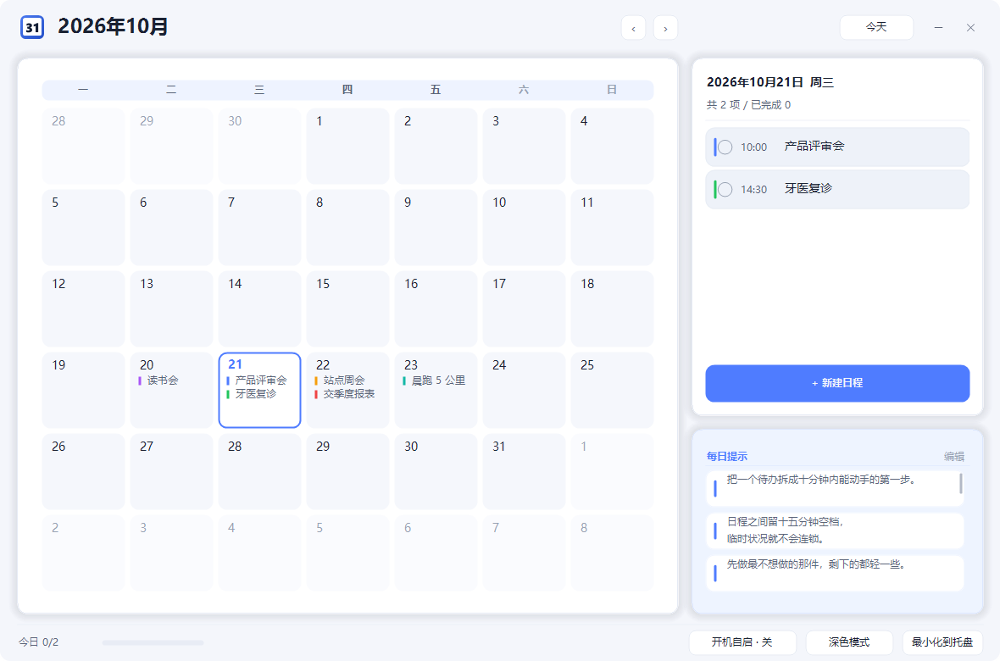
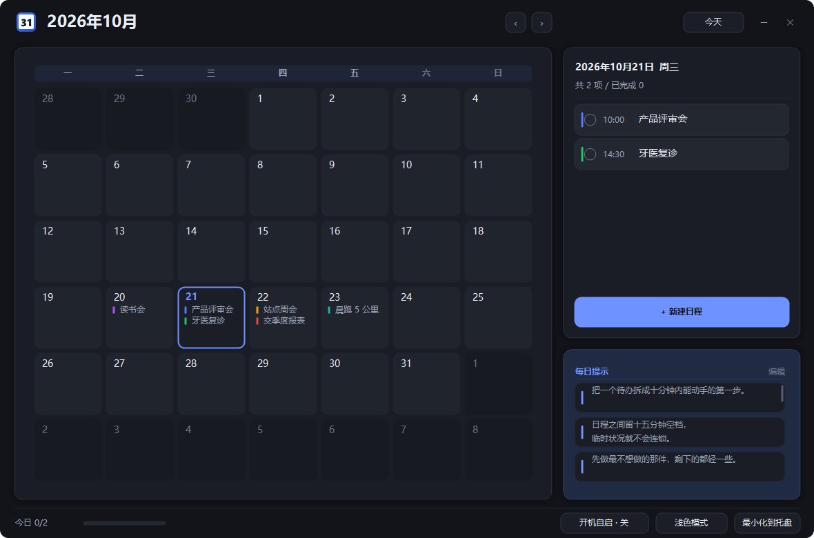
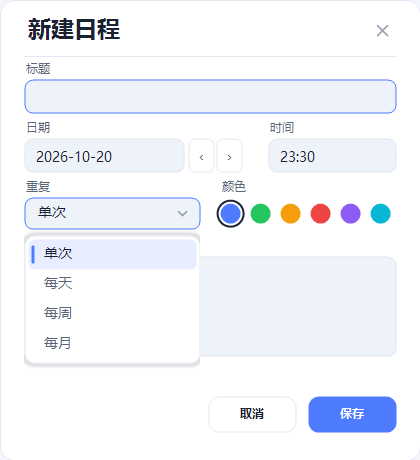
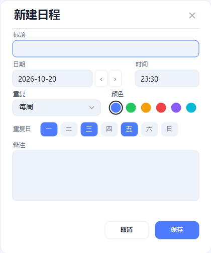

# desktop-calendar

一个给 Windows 用的**中文桌面日历 / 日程提醒**小工具：点开就是一个整月日历，双击某天就能写日程，到点在屏幕右下角弹出提醒卡片，托盘图标同时闪一下。单文件 exe，免安装，绿色运行。

`Windows 10 / 11` · `单文件 exe` · `.NET Framework 4.8` · `零第三方依赖` · `MIT`

## 功能特性

**月历浏览**

- 7 列 × 6 行整月网格，**周一起始**
- 今天用高亮底色标出，选中日另有描边高亮
- 每格最多显示前 2 条日程（分类色条 + 标题），超出显示 `+n`
- 滚轮切换月份，标题栏 `‹` `›` 也能切；`今天` 按钮一键回到本月

**日程**

- 字段：标题、日期、时间（HH:mm）、重复、分类颜色（6 色）、备注
- 重复规则：单次 / 每天 / 每周 / 每月，可选「重复至某日」
- 每周重复可**指定星期几**（`一 二 三 四 五 六 日` 七个按钮多选，至少保留一天）
- 每月重复遇小月没有该日时（例如每月 31 号），自动落到当月最后一天

**提醒**

- 应用内每 30 秒轮询检测到期项，到点弹出右下角提醒卡片
- 卡片置顶、淡入出现、不进任务栏，不打断你在做的事
- 三个按钮：`完成` / `+10 分钟` / `今天忽略`
- 逾期 30 分钟仍未完成，会以「已逾期」再次提醒
- 同时托盘图标闪烁 + 气泡提示

**任务监督**

- 侧栏显示当日「共 n 项 / 已完成 m」
- 列表里直接勾选完成
- 底部状态条显示今日进度
- 侧栏是**上下两张并列的卡片**：上面「当日日程」，下面「每日提示」（各占一半高度，日程卡里的「+ 新建日程」按钮仍然贴在日程卡底部）。提示像日程一样逐条列出，两张卡各自支持**鼠标滚轮**滚动；提示卡右上角「编辑」可自定义（新增 / 修改 / 删除 / 恢复默认，最多 50 条、每条 60 字，存在 `tips.json`）
- 托盘菜单显示今日待办数

**生命周期**

- 关闭窗口 = 隐藏到托盘，不退出进程
- 托盘菜单：打开日历 / 今日待办 / 开机自启 / 退出
- 单实例：重复启动只会唤醒已经在跑的实例
- 托盘图标直接取 exe 内嵌的 32×32 图标（高 DPI 下不糊），取不到才回落到代码绘制，不依赖外部散装 ico 文件
- 收起不再弹窗打扰：`×`或`最小化`直接静默进托盘
- 资源管理器（explorer）重启后靠 `TaskbarCreated` 广播自动把图标挂回去，不用重启程序

**外观**

- 明 / 暗双主题，运行时可切换
- 月历与日程栏是**两张独立的卡片**，各带柔和阴影与 1px 描边，中间留窗口底色间隙
- 日期格用色块区分（本月 / 非本月 / 今天 / 选中 / 悬停），不靠细线画格子
- 品牌图标：蓝色圆角方块 + 白色日历页 + 大号日期数字，`assets\app.ico` 内嵌进 exe（16/24/32 为简化档，48 以上带装订孔），托盘图标也取自同一份
- Win11 上使用 DWM 原生圆角与阴影
- 无边框自绘标题栏，整体沿用一套 Theme 色板，不做半调子混搭

## 截图

下面是真实运行窗口的截图（不是设计稿）：左边月历卡，右边上下两张卡——当日日程 + 每日提示，三张卡片各自带柔和阴影。

**浅色主题**



**暗色主题**（点状态条上的「深色模式」切换）



**到点真的会弹出来**（种子数据到点后截的实拍）


**新建 / 编辑日程**：重复规则是自绘下拉，选「每周」会多出一排星期几按钮。





**自定义每日提示**：点提示卡右上角「编辑」，可以新增 / 修改 / 删除文案、或一键恢复默认。


**品牌图标**（`assets/app.ico`，16/24/32 为简化档，48 以上带装订孔）


## 快速开始

### 方式一：直接下载现成的 exe（免编译）

到仓库的 [Releases](https://github.com/Morrismht/desktop-calendar/releases) 页面下载 `desktop-calendar.exe`，放到任意目录双击即可。

不需要安装、不需要 .NET SDK、不需要管理员权限。第一次运行会在 `%APPDATA%\DesktopCalendar\` 建一个 `data.json` 存数据。想换地方放，直接把 exe 复制走就行（数据不在 exe 旁边）。

### 方式二：从源码构建

`build/` 是构建产物、不进版本库，所以从仓库源码开始的话要自己编一遍。在仓库根目录打开 PowerShell，执行：

```powershell
.\build.ps1
```

产物是 `build\desktop-calendar.exe`。构建细节见下文「从源码构建」。

### 方式三：一键安装（推荐，顺手建好快捷方式）

仓库里的 `install.ps1` 会把 exe 装到当前用户目录、建好桌面和开始菜单快捷方式，并顺手清掉误放在桌面的裸 exe：

```powershell
powershell -NoProfile -ExecutionPolicy Bypass -File .\install.ps1
```

安装位置是 `%LOCALAPPDATA%\Programs\DesktopCalendar\`（不需要管理员权限，卸载就是删掉这个目录加两个快捷方式）。装到固定位置的好处是：自启动、快捷方式、托盘图标全都指向同一个 exe，不会出现「桌面放了一个、D 盘又放了一个、自启指向第三个」的混乱——之前找不到托盘图标、自启报拒绝访问，大半都是这种多副本导致的。

## 使用说明

1. **新建日程** —— 在左侧点选日期，再点右侧 `+ 新建日程`；或者直接**双击**日历里的某一天。填标题、时间，需要重复就选「每天 / 每周 / 每月」，可选填「重复至某日」；挑一个分类颜色方便区分；备注随意。保存即生效。
2. **改 / 删日程** —— 双击右侧列表里的日程进入编辑；要删就在编辑窗口里删除。
3. **重复规则** —— 单次只是那一天；每天从起始日期开始天天提醒；每周按起始日期所在的星期几；每月按起始日期的「日」。勾了「重复至某日」就在该日（含当天）之后不再提醒。
4. **完成 / 稍后 / 今天忽略** —— 提醒卡片的三个按钮：`完成` 记为本次已完成（重复日程只完成这一次，不影响下一次）；`+10 分钟` 十分钟后再提醒一次；`今天忽略` 当天不再提醒这条，明天照常。
5. **明暗切换** —— 底部状态条的明暗按钮切换主题，即时生效，下次启动沿用你的选择。
6. **最小化到托盘** —— 点关闭 `×` 或最小化按钮，窗口收进托盘，日程提醒照常跑。要回来就双击托盘图标，或右键托盘图标选「打开日历」。
7. **退出程序** —— 右键托盘图标 → `退出`。只关窗口是退不掉的，这是故意的。
8. **托盘挂不上时不会消失** —— 如果这台机器上托盘图标注册不成功（被杀软拦截、explorer 异常、远程会话里等），程序不会把窗口藏起来让你以为它关了，而是**退回成普通最小化留在任务栏**，同时写一条诊断日志。这样至少你能从任务栏把窗口点回来、从菜单里退出。

## 数据与隐私

- 所有日程保存在一个文件里：`%APPDATA%\DesktopCalendar\data.json`
- 纯本地 JSON，明文可读，想备份就直接复制这个文件
- **完全离线**：程序不联网、不上传、不发遥测、不带任何第三方库
- 写文件用「临时文件 + 替换」的原子写法，写到一半断电也不会把旧数据写坏

## 开机自启原理

开机自启不装服务，用的是 Windows 官方的当前用户启动方式，**三级依次兜底**，前一级被拒就自动换下一级：

| 顺序 | 机制 | 位置 | 说明 |
| --- | --- | --- | --- |
| 1 | 注册表启动项 | `HKCU\Software\Microsoft\Windows\CurrentVersion\Run` 下值名 `DesktopCalendar` | 最轻量，绝大多数机器走这条 |
| 2 | 启动文件夹快捷方式 | `%APPDATA%\Microsoft\Windows\Start Menu\Programs\Startup\DesktopCalendar.lnk` | 个别机器注入了 ObjectName 保护、或组策略禁写 Run 项时用这条 |
| 3 | 计划任务 | `schtasks /Create /TN DesktopCalendar /SC ONLOGON`（当前用户，无最高权限） | 前两条都被杀软/策略挡住时的最后一招 |

不管哪一级，登记的启动命令行都以 ` --silent` 结尾，表示静默启动：进程起来、托盘图标在、提醒照常走，但主窗口不弹出来。

- 全部机制都只作用于**当前用户**，因此不需要管理员权限，也不影响这台机器上的其他账号
- 程序内可以随时开关：底部状态条的自启开关，或托盘菜单里的「开机自启」勾选项
- 想手动确认是否生效：任务管理器 → 启动 里看 `DesktopCalendar`；或看「设置 → 应用 → 启动」
- 开关会**一级一级试**：成功的那一级会记下来，关的时候把三级里存在的都清掉，不会留下半开半关的状态
- 三级都失败时不会静默失败：状态条会给出具体原因（比如「注册表被拒：UnauthorizedAccessException」），完整堆栈写进诊断日志

## 从源码构建

本项目刻意只用**系统自带的 .NET Framework 4.8 编译器**，不需要装 Visual Studio 或 .NET SDK。

```powershell
.\build.ps1
```

脚本最终等价于下面这条手工命令（在仓库根目录执行）：

```powershell
$csc = "C:\Windows\Microsoft.NET\Framework64\v4.0.30319\csc.exe"
& $csc /nologo /target:winexe /platform:anycpu /optimize+ /codepage:65001 `
  /out:build\desktop-calendar.exe `
  /r:System.dll /r:System.Drawing.dll /r:System.Windows.Forms.dll /r:System.Core.dll `
  src\Models\Schedule.cs src\Models\RepeatRule.cs `
  src\Data\Json.cs src\Data\Store.cs `
  src\Services\AutoStart.cs src\Services\Scheduler.cs `
  src\UI\Theme.cs src\UI\Draw.cs src\UI\Chrome.cs src\UI\MonthView.cs `
  src\UI\MainForm.cs src\UI\ReminderCard.cs src\UI\EventEditor.cs src\UI\TrayController.cs `
  src\Program.cs
```

> ⚠️ **必须带 `/codepage:65001`**。源文件是 UTF-8 且含中文，缺了这个参数编译出来的程序里中文会变成乱码。所有源文件请保持 UTF-8（无 BOM）保存。
>
> 源文件必须**显式逐个列出**，不要用 `src\*.cs` 通配符——避免把临时目录里的调试文件混进最终构建。

### 语言级别限制

老编译器的 `/langversion` 只支持到 ISO-5，也就是 **C# 5**。所以源码里不能用这些现代语法：字符串插值 `$"..."`、`?.` 空传播、`nameof`、自动属性初始化器（`{ get; set; } = 1;`）、表达式体成员 `=>`、`using static`、`out var`、元组。

可以用：`var`、LINQ、lambda、`async/await`、对象初始化器、`string.Format`、匿名类型。

这不是偷懒，是硬约束：为了「一台干净的 Windows 上双击就能编译」，就得迁就这台机器上唯一的编译器。

## 目录结构

```
desktop-calendar/
├─ src/
│  ├─ Models/        Schedule.cs（日程实体）、RepeatRule.cs（重复规则判定）
│  ├─ Data/          Json.cs（手写 JSON 读写）、Store.cs（数据存取 + 原子写）
│  ├─ Services/      Scheduler.cs（30 秒轮询 / 提醒状态机）、AutoStart.cs（三级自启兜底）、
│  │                 DiagnosticLog.cs（诊断日志，%APPDATA% 不可写时退到 exe 同级）
│  ├─ UI/            Theme.cs、Draw.cs、Chrome.cs（主题 / 绘制 / 窗口外壳）
│  │                 MonthView.cs、MainForm.cs、ReminderCard.cs、
│  │                 EventEditor.cs、TipEditor.cs、TrayController.cs、Branding.cs（品牌标记）
│  └─ Program.cs     入口：单实例 Mutex、--silent、DPI 感知
├─ assets/           app.ico（多尺寸内嵌图标）、logo-256.png、make_icon.py
├─ tests/            五套自检（逻辑/提示/托盘×2/自启）+ run_all_tests.ps1（不参与 exe 构建）
├─ preview/          README 用的界面截图
├─ docs/使用说明.md    面向使用者的完整说明书
├─ build.ps1         一键构建脚本
├─ install.ps1       一键安装（装到 %LOCALAPPDATA%，建快捷方式）
├─ CONTRACT.md       产品定义与硬约束
└─ CONTRACT-V2.md    第二轮视觉规范补丁
```

## 常见问题

**Win10 下窗口没有圆角？**

正常。圆角走的是 Win11 的 DWM 原生 API，Win10 没有这个能力，程序会静默跳过，窗口就是直角。功能不受任何影响；Win11 上自动就有圆角和阴影。

**杀毒软件报毒 / 提示未知发布者？**

这是一个没有代码签名的自编译小程序，某些杀软对「无签名 + 写注册表启动项」的组合比较敏感，属于误报。介意的话可以自己按上面的命令编译一遍，或者把源码过一遍——代码量不大，也没有任何联网行为。

**Windows SmartScreen 提示「Windows 已保护你的电脑 / 无法识别的应用」？**

这不是报毒。SmartScreen 只看两件事：这个 exe 有没有数字签名，以及那个签名有没有攒够下载声望。本项目两个都没有，所以任何从浏览器下载到的 exe 都必然弹这一下。

**代码层面解决不了**——唯一的根治办法是购买代码签名证书（OV 或 EV，年费数百到上千元）后重新签名：EV 证书能较快取得信任，OV 证书还要再攒一段时间下载量。免费/自签名证书对 SmartScreen 无效，等于白签。

在此之前，三种做法任选：

1. **下载后先解锁（推荐，只需做一次）**：

```powershell
Unblock-File -Path "$env:USERPROFILE\Downloads\desktop-calendar.exe"
```

   它删掉文件上的「来自 Internet」标记（Mark-of-the-Web），之后双击不会再弹 SmartScreen。
2. 弹窗里点「更多信息」→「仍要运行」。
3. 干脆别下载：按「从源码构建」一节在本地编一遍。本地编译产物不带这个标记，永远不会弹。

**托盘图标看不见？**

Win11 默认把新出现的图标收进「隐藏的图标」溢出区（点 `^` 才看得到）。程序现在自己解决这件事：注册图标后读取 `HKCU\Control Panel\NotifyIconSettings` 下这条图标对应的设置，把 `IsPromoted` 置 1 再重登记一次，壳层就会把它摆到任务栏可见区，不用你手动拖。

也就是说：图标按 exe 内嵌的 32×32 原图、收起时静默进托盘不弹气泡、explorer 重启后自动挂回去、并主动从溢出区提到可见区；万一注册真的失败，会退成任务栏最小化而不是消失（见「使用说明」第 8 条）。如果还是看不到，按这个顺序查：

1. 任务管理器里看 `desktop-calendar.exe` 还在不在——不在就是被杀了或压根没启动
2. 看诊断日志（见下一条）里的 `tray:` 行，会写明注册成功与否、失败的错误码、explorer 的 pid，行尾还有 `promote=` 字段：`set:<注册表项>` 表示已把它提到可见区，`already` 表示本来就是常显，`no-entry` 表示壳层还没为这个 exe 建记录（再启动一次就会建）
3. 确认你点的是同一个 exe：桌面上残留的旧 exe 和安装目录里的新 exe 是两个不同路径，托盘设置按路径记

**程序到底把什么东西写到了哪里？出问题要看哪个日志？**

- 数据：`%APPDATA%\DesktopCalendar\data.json`（自定提示在同目录 `tips.json`）
- 诊断日志：`%APPDATA%\DesktopCalendar\diagnostics.log`，记录启动、托盘注册与「从溢出区提到可见区」、自启动开关的每一步结果和错误码；超过 256 KB 自动轮转成 `.old`
- 如果 `%APPDATA%` 本身不可写（极少见，通常是安全软件整目录保护），数据会退到 exe 同级的 `data\` 子目录，日志同理，程序会在状态条上说明

**每月 31 号的日程，2 月怎么提醒？**

会自动落到当月最后一天（2 月 28 或 29 日），不会漏。这是设计行为，不是 bug。

**关机 / 休眠期间错过的提醒会补报吗？**

不会补报。程序只有在自己运行着的时候才能检测到期项，睡过去的那段时间的提醒不会在你回来时一起炸出来。重启后请顺手看一眼侧栏的今日待办。

**重复日程点了「完成」，是不是以后都不提醒了？**

不是。完成只作用于**当次**，下一次照常提醒。要彻底停掉就编辑这条日程，把重复改成「单次」，或者直接把日期改掉 / 删掉。

## 已知限制

本项目是「够用就好」的从简版，只实现上面列出的功能，不做：

- 云同步 / 多设备 / 账号体系
- 日历订阅（.ics 导入导出）、与系统日历互通
- Windows 通知中心原生 toast（提醒卡片是应用自己画的窗口）
- 多日历分组、标签、搜索、统计报表
- 农历 / 节假日 / 纪念日倒数
- 代码签名（所以首次运行会碰到 SmartScreen 提示，处理办法见上面「常见问题」）

有需要就自己改——源码都在，编译只要一行命令。
